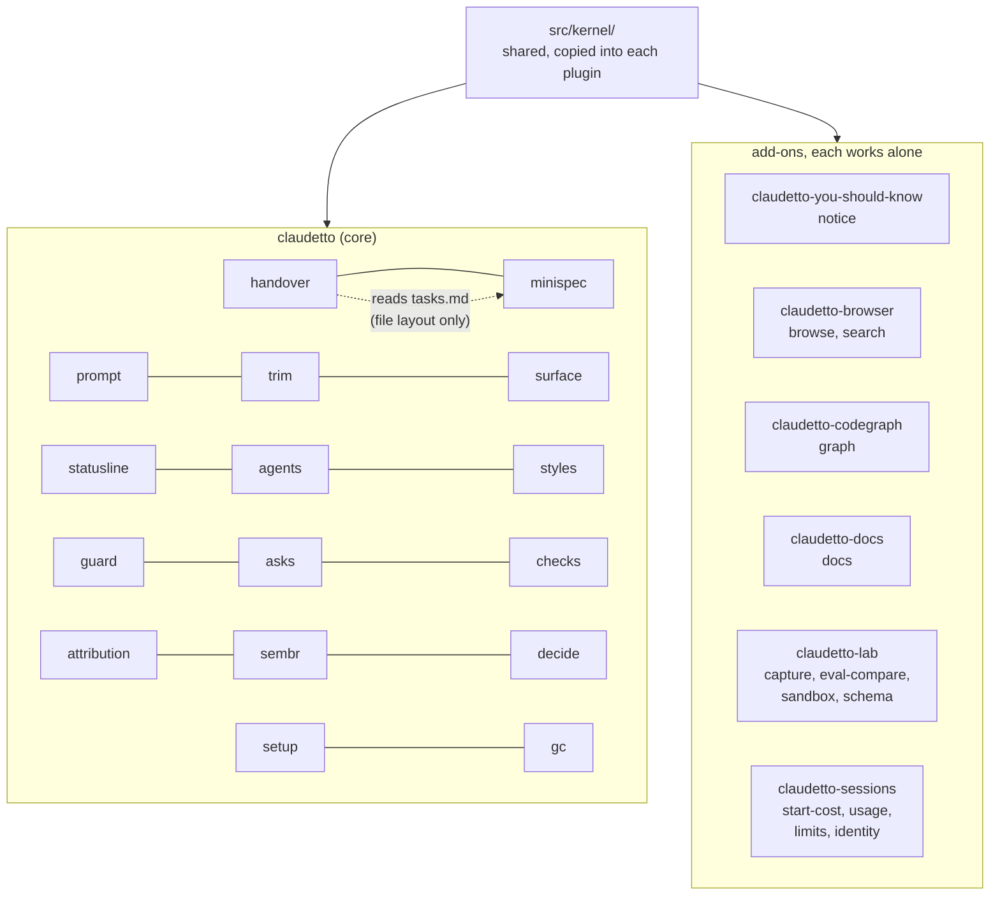
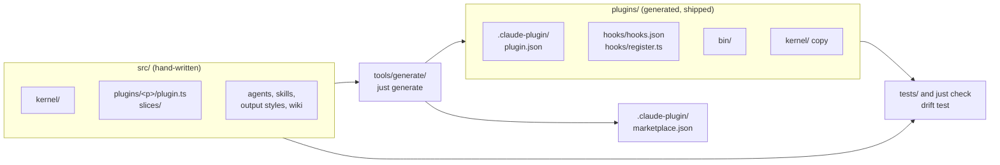
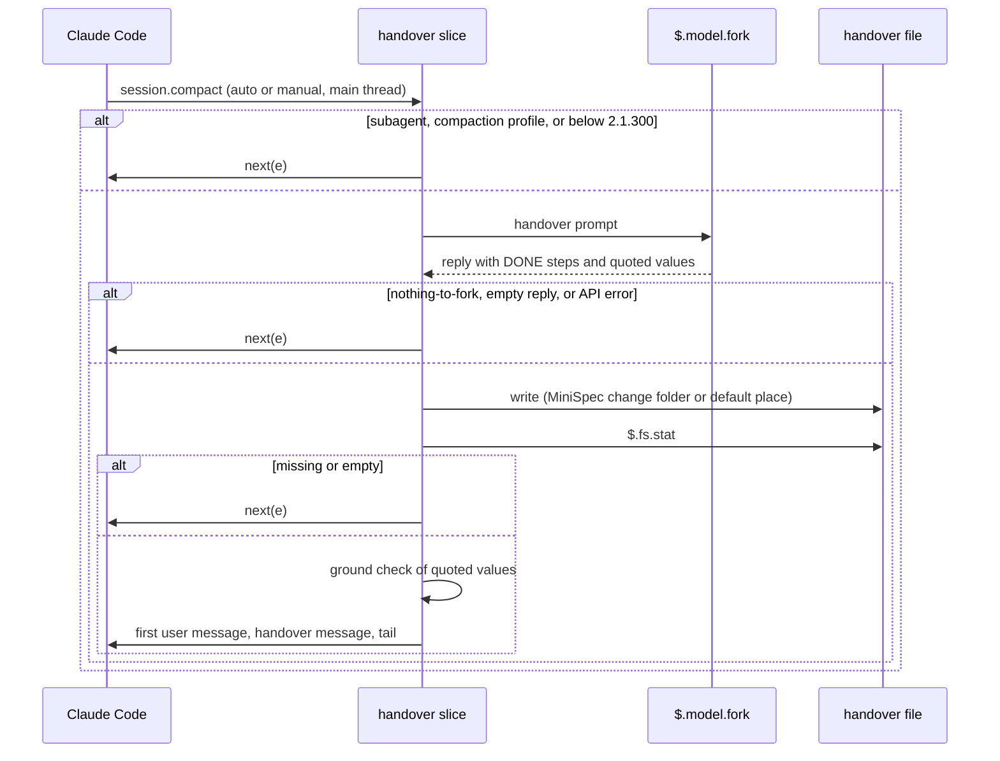
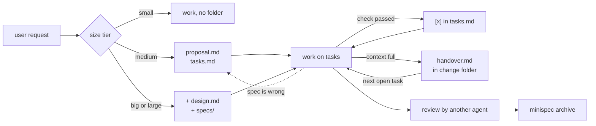

# Architecture: `claudetto`

This file gives the target architecture of `claudetto`, for 0.1.0 and for the releases after it.
The decisions and their reasons are in [design.md](design.md).
The requirements are in `specs/`.

## Layers

`claudetto` has 5 layers.
A layer imports only from the layers below it.

| Layer | Folder | What it holds | Imports |
| --- | --- | --- | --- |
| Kernel | `src/kernel/` | Pure code that the plugins share: the slice contract, bounds, paths, the shell reader, the policy catalog, and the model ids. | Nothing, except `src/kernel/node/` |
| Runtime adapters | `src/kernel/node/` | The adapters of Node and Bun: files, processes, hook input and output. | The kernel |
| Slices | `src/plugins/<plugin>/slices/<s>/` | One feature each, with `domain/`, `adapters/`, `lab/`, and `limits.ts`. | The kernel, and the adapters for a CLI only |
| Entry points | `src/plugins/<plugin>/` | `plugin.ts`, which lists the slices, and the text that the plugin ships: agents, skills, output styles. | The slices |
| Generator | `tools/generate/` | The build from `src/` to `plugins/` and the marketplace file. | Each layer, at build time only |

The rules of the layers:

- A slice never imports another slice.
  Slices share data only through a file layout that the kernel names in `src/kernel/paths.ts`.
  For example, the handover reads `minispec/changes/<name>/tasks.md` and does not import the `minispec` slice.
- A hooks module has no `node:` import and no `Bun`, so a mod handler imports only the pure kernel.
- A plugin never imports another plugin (D8).
  The generator copies each kernel file that a plugin uses into that plugin.
- Each slice states its rung of the decision ladder in one line of `slice.ts` (D2).

## Plugins and slices



The capability of each slice:

| Slice | Capability | Rung of the ladder |
| --- | --- | --- |
| `handover` | `handover` | Mod API (`session.compact`, `$.model.fork`) |
| `minispec` | `minispec` | Skills and the `minispec` CLI |
| `prompt` | `prompt-profile` | Mod API |
| `trim`, `surface` | `context-trim` | Built-in settings and env vars, then the Mod API |
| `statusline` | `status-line` | Built-in `statusLine` command |
| `agents` | `role-agents` | Plugin agents |
| `styles` | `output-style` | Plugin output style |
| `guard` | `command-guard` | Mod API |
| `asks` | `safety-asks` | Mod API |
| `checks` | `check-runner` | Mod API and a CLI |
| `attribution` | `commit-attribution` | Built-in `attribution` setting, then the Mod API |
| `sembr` | `semantic-breaks` | Mod API |
| `decide` | `decision-api` | A CLI, opt-in |
| `setup` | `settings-setup` | A skill and a CLI |
| `gc` | `output-gc` | Mod API and a classic `SessionEnd` hook |

The rungs in this table are the targets.
Task 1.3 adds the ladder line to each slice, and a slice goes down a rung only with a test or a lab run (D2).

## Build



`just check` fails when a file in `plugins/` differs from the output of the generator.
Only `plugins/` and the marketplace file ship to users.

## Handover flow



The tail holds each message from the last assistant message with a tool use, so the newest tool result stays in the context (`p4`, `p5`).
The ground check adds a warning to the handover message for each quoted value that is not in the messages of the session.

## MiniSpec and the handover



## File tree

The target tree for 0.1.0.
The names of slices and files can change in the work, but the layers and their rules do not.

```text
src/
  kernel/
    slice.ts            slice contract, phases, ladder line type
    budget.ts           shared runtime bounds (handover triggers)
    paths.ts            file layout that slices share
    errors.ts  model.ts  ports.ts  text.ts  temp-paths.ts
    shell.ts  shellkinds.ts  wrappers.ts  shell/
    policy/             destructive floor catalog
    node/               Node and Bun adapters
  fragments/            shared text, inlined by the generator
  plugins/
    claudetto/
      plugin.ts
      agents/  output-styles/
      slices/
        handover/  minispec/  prompt/  trim/  surface/
        statusline/  agents/  styles/  guard/  asks/
        checks/  attribution/  sembr/  decide/  setup/  gc/
    claudetto-you-should-know/  slices/notice/
    claudetto-browser/          slices/browse/  slices/search/
    claudetto-codegraph/        slices/graph/
    claudetto-docs/             slices/docs/
    claudetto-lab/              slices/capture/  eval-compare/  sandbox/  schema/
    claudetto-sessions/         slices/start-cost/  usage/  limits/  identity/
  wiki/                 source of the claudetto wiki pages
tools/
  generate/  validate.ts  limits.ts  lab.ts  sandbox/  wiki.ts  bump-version.ts
tests/
  kernel/  support/
  claudetto/<slice>/
  claudetto-<addon>/
plugins/                generated, do not edit
  claudetto/
    .claude-plugin/plugin.json
    hooks/hooks.json  hooks/register.ts
    bin/minispec  bin/claudetto-statusline  bin/claudetto-run-checks
    bin/claudetto-decide  bin/claudetto-setup
    agents/  skills/  output-styles/  kernel/  slices/
  claudetto-<addon>/    same shape, only the parts that the add-on uses
.claude-plugin/marketplace.json
```

Each slice folder has the same shape:

```text
slices/<s>/
  slice.ts      what the slice adds, and its ladder line
  limits.ts     bounds of the slice
  domain/       logic, no I/O
  adapters/     mod.ts, cli.ts, or hook.ts
  lab/          hook lab tests with stubbed events
  skills/       skill files, when the slice has any
```

The slices `rules`, `stamp`, `spec`, and `handoff` of dotclaude 1.0.0 go.
`handover` replaces `handoff`, and `minispec` replaces `spec`.

## Long term

The rules that keep the architecture stable after 0.1.0:

- **A new feature is a new slice.**
  It goes into the core only when most users need it.
  Otherwise it goes into an add-on, and the add-on works without the core.
- **The ladder is checked again for each Claude Code release.**
  When a new release gives a higher rung, such as a Mod API event for a feature that uses a classic hook, the slice moves up with a lab test.
  When a release removes a rung, the slice moves down, and the lab test shows the reason.
- **The minimum Claude Code version moves only with the lab.**
  A bump of the pin in task 1.5 needs `just lab` and the handover eval on the new version.
- **Bounds live in one place.**
  Shared bounds go to `src/kernel/budget.ts`, slice bounds to `slices/<s>/limits.ts`, and repository bounds to `tools/limits.ts`.
- **Shared state is a file layout, not an import.**
  When two slices need the same data, the kernel names the path, and each slice reads the file.
  This keeps a slice removable: remove its folder and its line in `plugin.ts`, and the other slices still build.
- **Each measured claim has an evidence file.**
  A change to the handover prompt, the ground check, or the trigger runs the handover eval again before it merges.
- **Self-improvement goes through settings and the repository.**
  A user changes `claudetto` through its settings or a pull request, not through the plugin cache, which updates overwrite.
