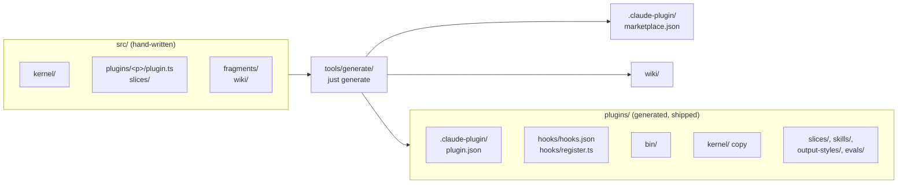

# Architecture Generate

This page tells how `just generate` builds `plugins/` and `wiki/` from `src/`.
A contributor reads it before a change to a text that a plugin ships.
It follows [Architecture](Architecture).

## The Rule

Only `plugins/` ships to users, and the generator writes all of it.
Edit the source in `src/`, then run `just generate`.
Do not edit `plugins/` by hand.
`just generate --check` names each generated file that differs from its source.
`just check` runs it, so a hand edit fails the check.

## The Flow

## What the Generator Writes

| Output | Source |
| --- | --- |
| `plugins/
/.claude-plugin/plugin.json` | `plugin.ts`, `description.md`, the `userConfig` of the slices, and `package.json`. |
| `.claude-plugin/marketplace.json` | `src/marketplace.ts` and the `plugin.ts` of each listed plugin. |
| `plugins/
/hooks/register.ts` | The `mod` handlers of the slices. |
| `plugins/
/hooks/hooks.json` | The module list, and the classic hooks of the slices. |
| `plugins/
/evals/hooks.json` | The `evals` field of each hook. |
| `plugins/
/bin/<name>` | One launcher for each `cli` of a slice. |
| `plugins/
/slices/<s>/` | The slice files, with the imports of `src/kernel/` changed to `kernel/`. |
| `plugins/
/slices/<s>/prompts.ts` | The folder `prompts/` of the slice. |
| `plugins/
/kernel/` | The kernel files that the plugin imports, and the files that those import. |
| `plugins/
/skills/`, `output-styles/` | The skills and the output styles of the slices. |
| `plugins/
/tests/` | The hook lab tests in `lab/`. |
| `wiki/` | The pages of `src/wiki/`, with a header that names the source. |
| `wiki/claudetto/rationale/Controls.md` | The `controls` field of each slice. |

## Texts and Values

- `{{include NAME}}` on a line gives the text of `src/fragments/NAME.md`.
  `{{include NAME.json}}` gives a JSON fragment.
  `{{include snippet.json}}` gives the settings snippet of the core plugin.
- An uppercase name in double curly braces gives a bound.
  The values are in `VALUES` of `tools/generate/emit/fill.ts`, and a prompt of a slice also gets the limits of its slice.
- `{{name}}` in lowercase in a `prompts/` file is a parameter.
  The code gives its value at run time.

## Checks of the Generator

The generator fails with a message on these faults:

- A `slice.name` that differs from the folder.
- Two mod handlers of one slice with the same event, filter, and phase.
- Two mod handlers of one event with no filter.
- A CLI without `adapters/cli.ts`.
- A file in `prompts/` that is not `.md` or `.json`.
- An uppercase name in double curly braces with no value.
- Two sources for one output file.
- A file in `plugins/` or `wiki/` that has no source.

The generator formats each `.ts` and `.json` output with Biome.
It sets the mode 755 on the files in `bin/`.

## Related Pages

- [Architecture](Architecture): the layers and the slices.
- [Plugin Layout](Plugin-Layout): the folders of `src/`.
- [Development](Development): the commands.
